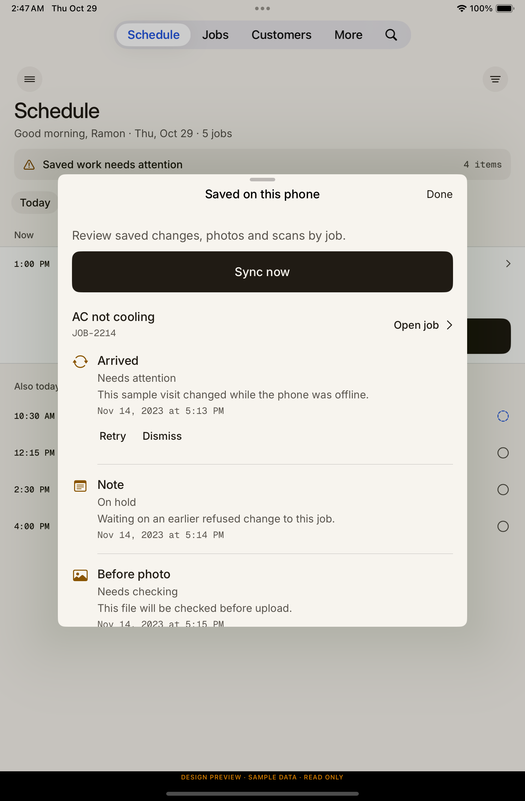
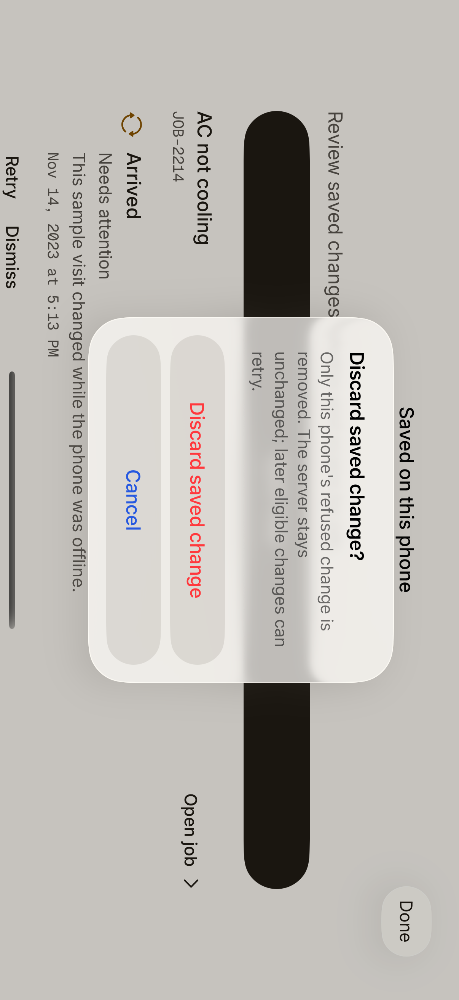

# Saved-work review implementation evidence

Approved Paper reference: Thorbis Mobile file 01KY0S86CYXENWSH216F3ZB058, artboards 73/74 (3YFX-1/3YK5-1), token hash 2803f4aa. Actual JSX and computed styles were read before implementation. Native adaptation retains planar job sections, 20pt gutter, shared Inter/mono type, semantic neutral/warning colors, 44pt targets and native navigation/confirmation.

Material runtime checks:

| Artifact | Observed result |
| --- | --- |
| /private/tmp/saved-work-guard-red.4DfH6Ssd/result.xcresult |17 cases;16 behavior assertions failed before guard implementation;exit 65 |
| /private/tmp/saved-work-projection-red.emvHzOwS/result.xcresult |53 cases;27 behavior assertions failed,1 simulator skip;exit 65 |
| /private/tmp/saved-work-ui-red.zEqjUgww/result.xcresult |1 native old-banner failure;exit 65 |
| /private/tmp/saved-work-outbox-scope-red.xcresult |2 cases;7 behavior assertions failed, including actual foreign-owner request;exit 65 |
| /private/tmp/saved-work-final-iphone.xcresult |122 cases:121 passed,1 simulator file-protection skip,0 fail;exit 0.112affected units+10native. |
| /private/tmp/saved-work-edit-revocation-red.xcresult |1 native stale-alert failure after actual edit-only capability revocation;exit 65 |

The last listed iPhone GREEN preceded the bounded edit-only alert-cancellation fix. Subsequent targeted iPhone checks passed 3/3, and iPad on iOS 18.2 passed 9/9, terminal 0. Strengthened whole-modal retirement passed 1/1 on each device. Exact final input hashes and receipts are in the private execution package. Core runtime sources unchanged by that view-only observation remain covered; no claim of a repeated full scheme/CI run.

Visual inspection: the intermediate native Done render and largest-text dark recovery render preserve hierarchy and wrapping without hiding reasons/actions. Exact uncached job route and native Back are visible, and nested job banner returns to one review owner. Unsupported ancillary preview reads are intercepted and displayed truthfully; no live backend fallback was used. The iPhone app-cropped landscape screenshot was malformed; full-screen comparison confirms correct rendering and identifies the crop artifact.

Historical concern remains open: initial integrated real-file relaunch retained4items and one visible banner, but tapping did not present the review. Later strict diagnostic-free relaunch passed; this is positive evidence, not proof of the earlier cause. The separate nested hidden-banner test ambiguity is not used to explain that failure. Failure screenshot/AX and transition diagnostics are preserved in the private execution ledger.

Production boundaries: no new queue/schema/payment/backend/SDK, no App resync/router rewrite, no new production authority timer. Both queue contexts are required opaque binding leases. Existing command IDs/holds/media bytes are retained. DEBUG fixture identity/reset/control/proof code is absent from Release compilation by source guards; archive binary verification/signing/upload remain coordinator work.

Final modal-retirement screenshots show the original new-workspace Schedule usable, with no sheet or previous jobs. Both owned simulator namespaces contain zero saved-work fixture files after per-session cleanup. Actual edit-only revocation receipts on both devices preserve all seven file SHA256 values and zero mutation attempts while retaining the same valid read-only lease. Historical initial relaunch intermittency remains unexplained; later passing runs are not labeled its causal repair.

Independent whole-task review: no Critical/Important findings; one deferred disabled-link visual affordance issue. Root verified all15 review inputs and the nine-file runtime aggregate. See the execution record for exact scope and preserved relaunch uncertainty.

These are actual simulator fixture renders; their sample content is not a live workspace or physical-device qualification.
