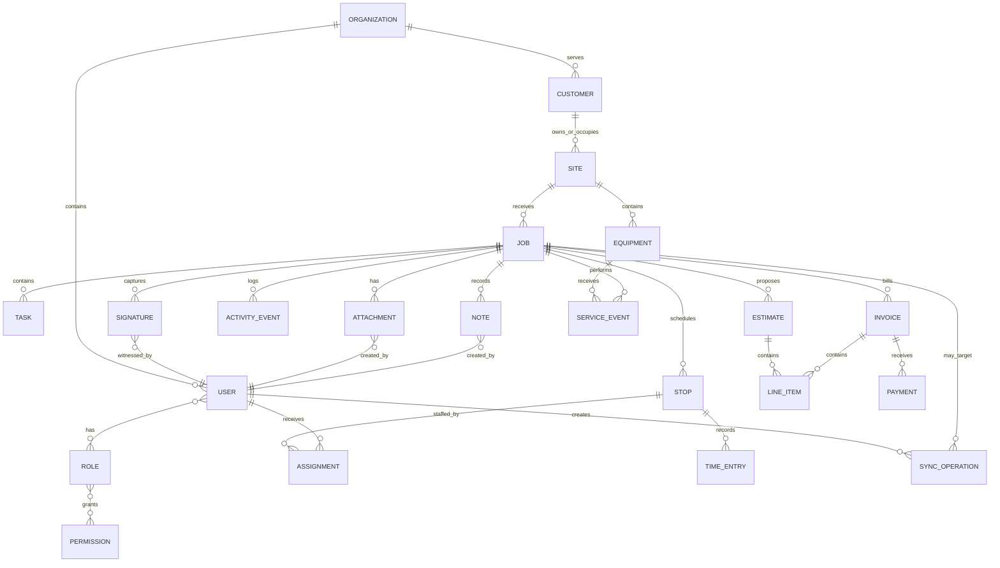
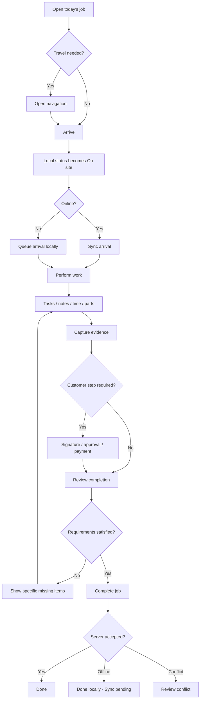
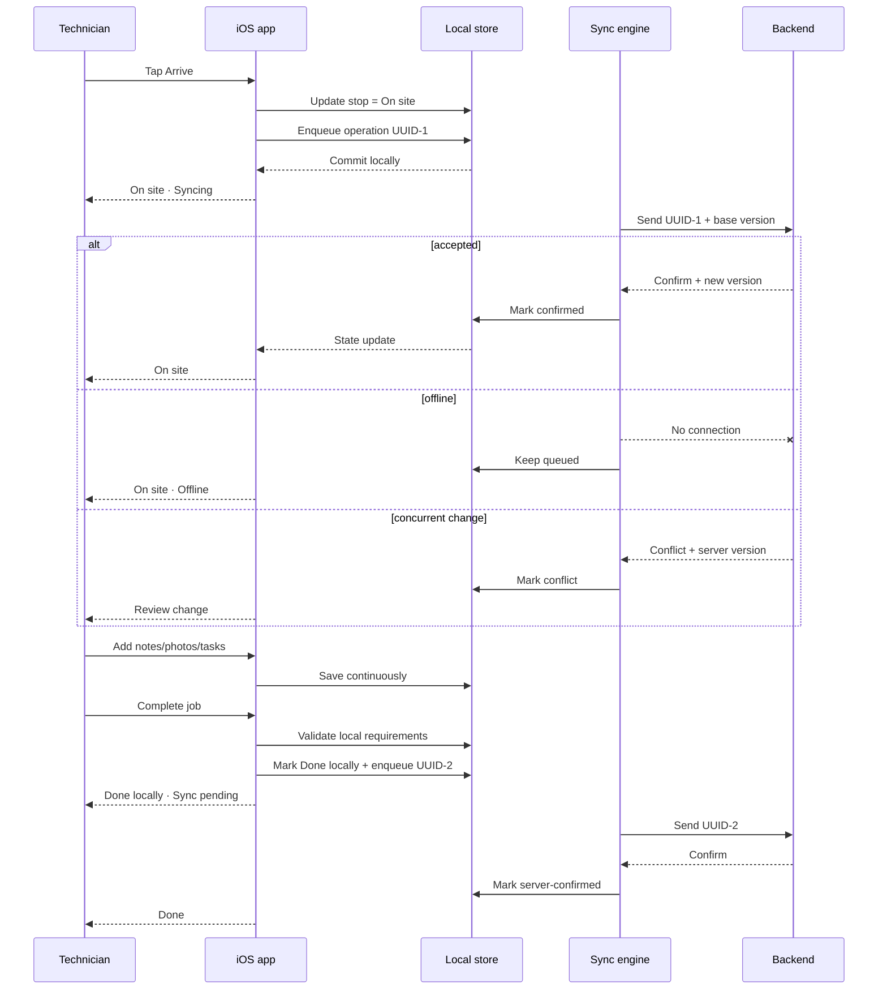

# iOS Field Management System Design Guidelines

## Executive summary

The strongest design direction is **not** to visually blend Thorbis, Linear, and Apple into a hybrid skin. Instead, assign each source a clear job:

| Source | What to inherit | What not to copy literally |
|---|---|---|
| **Thorbis Design System** | Operational vocabulary, quiet hierarchy, one dominant action, place-first job identity, flat work surfaces, explicit degraded/offline states, its spacing/depth philosophy, and the principle that a native iPhone app is a tab bar plus navigation stack rather than a squeezed desktop product. Thorbis explicitly distinguishes the iOS field experience from the desktop dispatch workbench. citeturn9search0turn1view0 | The web implementation kit, desktop sidebar, keyboard-first interaction model, or every web-specific token. |
| **Linear Mobile via Mobbin** | Information density without visual heaviness; grouped lists; compact metadata; large, clear record titles; bottom-accessible navigation/search; quick creation; properties expressed as compact controls; full-screen editing when the keyboard is active; activity/history below the record. These patterns are visible in the Linear Mobile references examined on Mobbin. | Linear's issue vocabulary, purple/brand styling, exact tab bar treatment, or issue-specific hierarchy. Thorbis itself describes the goal as learning Linear's grammar rather than copying its dress. citeturn9search0 |
| **Apple HIG and current iOS design** | Native navigation, tab bars, sheets, search, safe areas, Dynamic Type, SF Symbols, semantic colors, accessibility, system permissions, platform motion and current Liquid Glass behavior for navigation/control chrome. Apple now describes the interface as a control/navigation layer above a content layer where app identity can be expressed. citeturn10search6turn10search21turn10search22 | Rebuilding system controls from scratch merely to make them resemble Thorbis or Linear. |
| **OWASP / platform security guidance** | Secure local storage, object- and function-level API authorization, data minimization, Keychain-backed credentials, encrypted transport, and privacy-conscious analytics. citeturn13search0turn13search1turn13search15 | Client-side permissions as a substitute for server authorization. |

The resulting product should feel like **a native iPhone tool designed for someone standing next to the work, not a mobile admin dashboard**. Thorbis explicitly frames iOS as the experience of a technician in the field, calls for a tab bar and navigation stack, a 44-point touch model, Dynamic Type, bottom sheets, and system chrome; it simultaneously says that degraded states such as pending, stale, partial, conflicted, failed, and offline are real product states that should be represented honestly. citeturn9search0turn1view0

The primary screen should therefore answer four questions almost immediately:

**Where am I going? What is happening there? What do I do next? Is my work safely recorded?**

A technician should typically see the **street/address first**, a short problem description second, time and status as supporting metadata, and one unmistakable next action such as **Arrive**, **Start work**, **Collect signature**, or **Complete job**. This follows Thorbis's explicit preference for address-first field records, status expressed as words rather than ambiguous dots, and one principal action rather than a dashboard of equally weighted controls. citeturn9search0

The app should be **offline-first rather than merely offline-tolerant**. Core job data, current-day schedule, notes, forms, signatures, and attachment metadata should be readable from a local persistent store; user changes should enter a durable local outbox and synchronize when connectivity permits. Apple provides local persistence frameworks intended for offline use, background task APIs for opportunistic refresh and processing, and background URL sessions for transfers that need to continue outside the foreground. citeturn4search0turn4search12turn4search1turn4search38

**Assumptions.** The design below treats the product as a horizontal field-management platform adaptable to plumbing, HVAC, electrical, facilities maintenance, construction service, inspection, appliance service, and similar dispatch-to-field workflows. Organization size, industry regulation, pricing model, and exact back-office functions are intentionally open-ended. The assumed architecture is a multi-tenant SaaS service with iPhone as the principal field device, optional iPad support, intermittent connectivity, role-based access, media capture, and server synchronization. Payment, regulated signatures, GPS tracking, health/safety records, and industry-specific compliance should be specialized when the target market becomes known.

A useful product-level design constitution is:

> **Quiet chrome. Dominant work. One obvious next action. Place before database ID. System UI stays native. State is never hidden. Offline work is real work.**

That formulation is a synthesis of Thorbis's field-oriented rules, the Linear patterns observed through Mobbin, and Apple's current separation of system UI/navigation from app-specific content. citeturn9search0turn10search6

## Product model, roles, and experience principles

The app should share one underlying information architecture while emphasizing different actions by role. Avoid building separate mini-apps for every role unless workflows truly diverge; differences should generally appear as permissions, saved views, filters, and contextual actions.

| Role | Mobile priorities | Default landing state | High-frequency actions |
|---|---|---|---|
| **Field technician** | Today's work, directions, customer/site facts, task execution, evidence, parts/time, notes, signature, completion | **Jobs → Today** | Open job, navigate, arrive, take photos, add work, change status, message office, collect signature, complete |
| **Crew lead / senior tech** | Technician workflow plus crew coordination and approvals | **Jobs → Today / Crew** | Reassign within crew, approve work, review evidence, create follow-up |
| **Dispatcher / coordinator** | Exceptions rather than full desktop dispatch board | **Jobs → Team** | Reassign, contact tech/customer, insert emergency work, review late jobs |
| **Estimator / salesperson** | Site/customer context, estimate creation, media, approval | **Jobs / Customers** | Capture scope, build estimate, attach evidence, obtain approval |
| **Supervisor / service manager** | Exceptions, quality, workload, approvals | **Jobs → Exceptions** | Review overdue jobs, failed sync, callbacks, safety flags, approve adjustments |
| **Owner / office administrator** | High-level operational visibility and sensitive actions | **Inbox / Search** | Review escalations, payment exceptions, permissions, customer issues |
| **Customer-facing participant** | Only a narrow transaction surface when needed | Dedicated guided screen | Sign, approve, pay, view document |

The role model should be **capability-based underneath**, even if the user interface describes human roles. A field technician may have `job.read`, `job.update_status`, `attachment.create`, and `signature.create`; a supervisor may additionally have `assignment.update`, `job.reopen`, and `invoice.adjust`. Server-side enforcement is essential because OWASP identifies broken object-level and function-level authorization as major API risks and recommends checking authorization whenever an endpoint acts on a supplied object identifier or privileged function. citeturn13search1turn13search15

**The central object should be the job at a place.** A job may contain one or more scheduled stops or visits, assignments, tasks, equipment, notes, attachments, estimates, invoices, payments, signatures, and activity events. The database ID should remain secondary. Thorbis's own examples lead with a street such as “114 Oak,” not an internal ticket number, and use operational nouns such as job, stop, tech, and truck rather than generic SaaS terminology. citeturn1view0turn9search0

The conceptual entity model should look approximately like this:



The experience should support several primary workflow families.

| Workflow | UX objective | Important design behavior |
|---|---|---|
| **Begin day** | Establish today's sequence without forcing navigation through dashboards | Load local Today list immediately; show sync freshness unobtrusively |
| **Open job** | Establish place, problem, status, and next action | Address/title first, contextual primary action visible without scrolling |
| **Travel / arrive** | Make one-handed state transition easy | One large **Arrive** commit; optional navigation action; haptic after accepted commit |
| **Perform work** | Keep operational context visible while exposing tools progressively | Tasks, notes, equipment, parts/time and attachments grouped below summary |
| **Capture evidence** | Fast camera loop without losing job context | Camera opens directly from attachment control; local thumbnail appears before upload |
| **Customer handoff** | Make the customer-facing step obvious and private | Dedicated guided screen for signature/payment rather than exposing internal notes |
| **Complete job** | Validate required evidence and present consequences | Review missing required items, then explicit completion action |
| **Emergency dispatch** | Let supervisor add or reassign work with minimal interruption | Quick-create transaction followed by assignment |
| **Offline work** | Preserve full core workflow without fake success | Local commit → pending state → background sync → confirmed or conflict state |
| **Recover conflict** | Explain what changed and preserve user work | Human-readable comparison and clear choice, not silent last-write-wins |

Thorbis's strongest applicable principle is its concept of **surface roles**: durable records belong in durable places; momentary transactions belong in modals/sheets; local choices belong in popovers/menus; contextual information can use an inspector or, on phone, a bottom sheet. It specifically treats job/customer/invoice/search as durable places and actions like assignment or payment as transactions. citeturn9search0

This maps well to field software:

| Information/action | Recommended surface |
|---|---|
| Job, customer, site, equipment, invoice | Navigation destination / record screen |
| Assign technician, collect payment, complete job | Sheet or focused transaction screen |
| Status, technician, date, category | Menu/picker |
| Customer/site context while editing | Bottom sheet on iPhone |
| Small title or quantity change | Inline edit |
| Destructive void/cancel/reopen | Explicit confirmation alert or sheet |
| Search across all records | Dedicated search destination |
| Add note/photo | Inline or short transaction depending complexity |

## Information architecture and workflow design

The default iPhone architecture should be **shallow and predictable**:

```text
Tab bar
├── Jobs
│   ├── Today
│   ├── Upcoming
│   ├── Team / Exceptions (permission-dependent)
│   └── Job detail
│       ├── Work
│       ├── Activity
│       └── Related records
├── Arrive / Current
│   └── Guided current-stop workflow
├── Inbox
│   ├── Messages
│   ├── Dispatch changes
│   └── Approvals / alerts
└── Search
    ├── Jobs
    ├── Customers / sites
    ├── Equipment
    └── Documents
```

A tab bar is Apple's standard control for navigating top-level sections, and Apple's current search patterns support a dedicated Search destination that can become a search field when selected. citeturn3search0turn3search16turn10search3turn10search5 Thorbis independently specifies “tab bar and stack” for iOS and gives **Jobs, Arrive, Inbox** as its field-oriented example. citeturn9search0

The proposed addition of **Search** is intentional. Linear Mobile currently presents search as a prominent bottom-reachable destination, as seen in the [Linear Search reference on Mobbin](https://mobbin.com/screens/6b4636c4-f715-4a2b-ae04-cc6412ff788c). Apple's current iPhone search guidance also supports bottom-oriented search patterns. citeturn10search3turn10search5

**Jobs should be the stable home.** Avoid a generic dashboard full of counts, charts, quick links, and cards. Thorbis explicitly rejects an equal-button dashboard in favor of one action and describes list as the default operational room. citeturn1view0turn9search0 A technician's starting list should instead be directly useful:

```text
Today                              [•••]

7:40
114 Oak Street
Leak under kitchen sink       Open

8:45
22 Pine Road
No heat                     En route

10:30
8 Mill Avenue
Water heater replacement       Open

                 Current stop
              [   Arrive   ]
```

The list hierarchy should generally be:

**time → address → problem/service → status → compact secondary facts**

Do not show a job number as the visual title unless the business truly works by that number. Status must be textual — **Open**, **En route**, **On site**, **Waiting**, **Done**, **Syncing**, **Failed** — with color acting as reinforcement rather than the only carrier of meaning. This follows both Thorbis's explicit status rule and Apple's accessibility guidance to avoid communicating meaning solely through visual treatment such as color. citeturn9search0turn2search1

The [Linear issues-list reference](https://mobbin.com/screens/0b396f0b-077e-41e9-896b-704c4fab59ee) demonstrates useful mobile grammar: records are grouped under small state headings, metadata is compact, primary content dominates, and creation is available without turning every row into a card. A second [Linear project issues reference](https://mobbin.com/screens/3810be1f-d4fa-4938-ae09-d7a2651c0274) shows the same density with priority groupings. These should inform density and hierarchy rather than visual imitation.

**The job screen is the core workspace.** Its hierarchy should be:

```text
< Jobs                       •••

114 Oak Street
Leak under kitchen sink

Open · Today 7:40–9:00
Mike Reyes · Service

[           Arrive           ]

Customer
Jane Smith
(555) 555-0123

Work
□ Diagnose source
□ Repair leak
□ Test fixture

Photos & files              3 >
[image] [image] [ + ]

Equipment
Kitchen faucet · Moen

Notes
...

Activity
7:12 Dispatched to Mike
6:58 Customer confirmed
```

The record should avoid a separate “overview card” enclosing everything. Thorbis's hierarchy is planar: the **sheet is the work**, with spacing and tone providing structure before borders or cards. citeturn9search0 The [Linear issue-detail reference](https://mobbin.com/screens/ed788cb0-3715-4383-9cbd-783d2a55bdf8) provides an instructive pattern: strong record title, compact properties directly below it, body content, related work, then an activity history; its [dark-mode counterpart](https://mobbin.com/screens/b64a923b-dad7-457f-aaa6-0fb31dc826c9) demonstrates the same hierarchy without redesigning the information architecture.

**Guided work should be sequential but escapable.** An Arrive/current-stop mode can reduce the active workflow to one clear step at a time without turning the entire product into a wizard:



A successful offline transition must **not** be represented as server-confirmed. Thorbis explicitly says pending, stale, partial, conflicted, failed, and offline states are real interface states and warns against painting success merely because part of an operation succeeded. citeturn1view0turn9search0

**Back navigation should remain native.** Do not disable or reinterpret interactive swipe-back in ordinary navigation. Thorbis specifically calls swipe-back “sacred” for its iOS profile, while Apple's navigation patterns depend on predictable system hierarchy. citeturn9search0turn3search12

## Interface system and component library

The component library should distinguish **system chrome** from **Thorbis-flavored content**. This becomes especially important in current iOS because Apple's Liquid Glass design is intended primarily for navigation/actions layered above content, while the content layer is the natural place for product identity. Apple has also refined Liquid Glass through iOS 27 and recommends using standard platform components rather than painting the same material indiscriminately through app content. citeturn10search6turn10search12turn10search21

### Component specification

| Component | Variants | Recommended behavior | Avoid | Basis |
|---|---|---|---|---|
| **Primary commit button** | Default, loading, success, destructive | One principal commit per transactional viewport. Keep label stable while a small glyph can become progress/check. Full-width in guided field steps. | Multiple equally prominent buttons; spinner replacing the label; flush-to-screen-edge placement | Thorbis uses one dominant action, stable control geometry, and lifted commits. citeturn1search0turn9search0 |
| **Secondary action** | Text, quiet bordered, menu item | Use for actions such as Directions, Call, Add note | Secondary action visually competing with Arrive/Complete | Thorbis emphasis hierarchy. citeturn9search0 |
| **Icon action** | Toolbar/system symbol, circular content control | Search, close, back, overflow, camera when meaning is obvious; always provide accessibility label | Unlabelled custom pictograms | Apple recommends SF Symbols for interface iconography; Thorbis requires accessible names on icon-only controls. citeturn11search8turn9search0 |
| **Job list row** | Default, selected, pending, failed | Flat full-width row; address/title leads; supporting information below/adjacent | Card around every job; divider-heavy table | Thorbis treats lists as primary operational surface and discourages separators/cards used merely for decoration. citeturn9search0 |
| **Card** | Media preview, financial summary, exceptional grouped object | Reserve cards for genuinely bounded objects | Using cards simply to create hierarchy | Thorbis prioritizes tone, alignment, rhythm, and proximity before boxes. citeturn9search0 |
| **Status** | Open, en route, on site, waiting, done, cancelled, sync states | Always display status word; optional symbol/color | Standalone green/red/yellow dot | Thorbis explicitly requires status words. citeturn1view0turn9search0 |
| **Filter chip** | Unselected, selected, removable | Quick filters such as Today, Mine, Emergency; use a sheet for advanced filters | Large “filter dashboard”; dozens of horizontal chips | Thorbis uses chips as quiet controls; Linear's mobile list patterns keep scope selectors compact. |
| **Segmented control** | Two to four peer views | Suitable for Today / Upcoming or Work / Activity when options are mutually exclusive | More segments than comfortably fit, navigation hierarchy disguised as segments | Apple defines segmented controls as peer-selection controls rather than general navigation. citeturn2search9 |
| **Text field** | Normal, focused, help, error, disabled | Persistent label; example placeholder; help/error occupies same supporting slot; validate on blur/commit | Placeholder as label; red outline alone; toast for field error | Thorbis forms model. citeturn1search0turn9search0 |
| **Picker/menu** | Short menu, date picker, searchable selection sheet | Small enumerations use menu; large tech/customer lists become searchable sheet | Custom dropdown behaving unlike iOS | Apple pickers and menus provide established choice behavior. citeturn2search2turn2search11 |
| **Search** | Global Search tab, contextual list search | Use system search field; keep query persistent while inspecting records | Tiny search icon that opens a custom floating overlay for complex cross-record research | Apple provides dedicated search patterns; Thorbis treats substantive search as a durable workspace. citeturn3search16turn10search3turn9search0 |
| **Map** | Map view, map + bottom preview, location picker | Use MapKit; annotations represent jobs; cluster dense markers; list remains available | Making map the only way to find jobs | MapKit supports annotations and automatic clustering. citeturn12search23turn12search15 |
| **Offline banner** | Offline, stale, authentication expired | Page-level issue appears near top and remains visible without blocking core work | Toast saying “offline” and disappearing | Thorbis explicitly says a banner is appropriate for page-level problems such as offline state. citeturn9search0 |
| **Per-record sync mark** | Pending, uploading, failed, conflict | Small textual/symbol state adjacent to affected object; tap for details/retry | Global spinner that hides which record failed | Thorbis recovery/state model. citeturn1view0 |
| **Attachment tile** | Local, uploading, uploaded, failed | Immediate local thumbnail; reserved aspect ratio; progress overlay; retry | Blocking job save until upload finishes; layout jump after image loads | Thorbis explicitly reserves media geometry before loading. citeturn1search0 |
| **Signature pad** | Empty, signed, review | Dedicated customer-facing sheet/full-screen step; clear signatory name and acceptance text; preserve immutable resulting artifact | Tiny signature box inside a long technician form | PencilKit supports low-latency drawing/annotation capabilities on Apple platforms. citeturn2search3 |
| **Notification/inbox row** | Unread, read, urgent | State what changed and link to related object | Push notification as substitute for in-app state | Apple recommends notifications be permissioned and used intentionally. citeturn6search3turn6search29 |
| **Success feedback** | Inline state, transient confirmation | Prefer changed state plus light haptic; toast only for noncritical confirmation | Toast as sole evidence that money/status/destructive change succeeded | Apple recommends multimodal feedback; Thorbis reserves modal confirmation for high-consequence operations. citeturn3search2turn9search0 |
| **Destructive action** | Cancel, void, delete, reopen with consequences | Separate visually; state exact consequence; confirm when harm is meaningful | Red icon with ambiguous wording; destructive swipe as only path | Thorbis requires consequence-naming confirmation for important destructive operations. citeturn9search0 |

**Buttons and touch geometry.** Thorbis specifies 44 points for isolated mobile touch controls. Apple's current guidance also emphasizes adequate separation and comfortable hit areas rather than tiny icon targets. citeturn9search0turn3search19 A visible icon may be 16–22 points while its hit region remains at least 44×44 points. Do not let adjacent hit regions overlap.

**Forms.** A field-service form should rarely look like an enterprise web form transplanted to iPhone. Each field needs a persistent human label, the correct keyboard/input type, clear optionality, and a local validation sentence. Thorbis recommends example-like placeholders, inline help with errors occupying that same location, and validation after blur or attempted commit rather than interrupting every keystroke. citeturn1search0turn9search0 Apple's data-entry guidance similarly recommends avoiding manual entry when the information can reasonably be obtained through an existing system capability or permission. citeturn6search14

For a longer create/edit operation, the Linear pattern is particularly useful. In the [Linear create-issue screen](https://mobbin.com/screens/3059880f-c519-44a3-9e6a-5323e3210d1e), the editor becomes a focused full-height surface with close and commit controls at the top, content filling the center, compact property controls immediately above the formatting/keyboard region, and attachment/formatting actions near the thumb. The [Linear creating-an-issue flow](https://mobbin.com/flows/3e4a012b-8efb-4107-98eb-02f351f9fa3c) shows the transaction returning cleanly to the issue list after completion. The field-management equivalent is appropriate for **Create job**, **Add work note**, or **Write estimate**, but not for changing a simple status.

**Filters.** Keep two levels. Common filters such as **Today**, **Mine**, **Emergency**, and **Unfinished** may appear as compact chips or a segmented control. The full filtering surface should be a sheet with technician, team, status, date, service type, zone, and saved view. Filters should persist when a person returns to the list; Thorbis explicitly treats list display preferences, filters, and saved views as state rather than temporary decoration. citeturn9search0

**Maps.** Use a map as an alternate spatial view, not the primary schedule. The map should use standard MapKit interaction and annotation behavior; MapKit supports custom annotations and clustering when markers become dense. citeturn12search5turn12search15 Selecting a marker should reveal a compact bottom sheet containing address, service problem, time/status, and the one relevant action.

**Camera and attachments.** Provide two actions: **Take photo** and **Choose from Photos**. Camera access requires explicit user permission, while Apple's Photos picker provides a privacy-preserving system interface for selecting media without building a broad custom library browser. citeturn6search2turn6search1turn6search5 Photos captured for a job should appear instantly as local thumbnails, carry upload state, permit caption/annotation, and retain the relationship to the job even when the binary has not uploaded.

A high-throughput technician camera may justify a custom `AVCaptureSession` so a user can capture several photos without repeatedly leaving the camera; AVFoundation provides the capture infrastructure for this. citeturn6search13 A simpler implementation can use system presentation. Do not request microphone permission for ordinary still photography unless a workflow actually captures audio/video.

**Signatures.** Treat a signature as a transaction, not a doodle field. The customer should see what is being accepted, signatory name, relevant amount/scope, a clear **Accept and sign** action, and a post-signature artifact. The backend should store an immutable signature record containing the rendered signature, signer label, document/version hash or reference, timestamp, job, and audit context. Whether additional legal language, identity verification, or consent is required depends on target jurisdiction and industry and must be validated separately.

**Notifications.** Push should be reserved for changes that justify interrupting the user: newly assigned job, meaningful schedule change, direct office message, customer cancellation, approval needed, or other time-sensitive exception. Apple requires user consent before notifications are sent and advises sparing use; ask at a moment when the value is obvious rather than on the first launch. citeturn6search3turn6search23 For an active, time-bounded job or upcoming stop, a Live Activity may be appropriate if it gives useful glanceable progress; Apple's Live Activities are designed around ongoing tasks and events rather than generic status feeds. citeturn6search10turn11search10

## Visual language, accessibility, and platform behavior

**The visual hierarchy should be more Thorbis than generic iOS content, but more Apple than Thorbis in system chrome.** Apple's current design explicitly separates the UI layer — navigation and controls — from app content, and recommends using the content area for distinctive product expression. citeturn10search6 That resolves the largest potential tension between Thorbis and current iOS.

### Layout and spacing

Adopt Thorbis's spacing rhythm as a semantic design-token scale:

| Token | Value | Typical use |
|---|---:|---|
| `space.xs` | 4 pt | icon-to-label |
| `space.sm` | 8 pt | inside compact controls |
| `space.md` | 12 pt | adjacent controls / field-to-action |
| `space.row` | 16 pt | normal row horizontal/vertical padding |
| `space.group` | 24 pt | related group separation |
| `space.section` | 32 pt | major section separation |
| `space.chapter` | 48 pt | strong content transition |

Thorbis defines this 4/8/12/16/24/32/48 rhythm and emphasizes tight spacing inside a conceptual group and generous spacing between groups. citeturn1search0

Use Apple's safe areas and adaptive layout system rather than fixed device-frame coordinates. Apple recommends respecting safe areas, margins, and layout guides, and the current platform direction increasingly expects apps to adapt to different window sizes and contexts rather than rely on one hard-coded iPhone width. citeturn3search1turn10search21

For iPhone, use **16-point standard content padding** as the working default unless a native component supplies its own margins. Primary guided actions sit inside this padding, never touching the physical screen edge.

### Radius and depth

Thorbis's recommended content geometry provides a useful baseline:

| Object | Recommended content treatment |
|---|---|
| Commit/action | ≈10 pt radius when custom Thorbis content control is appropriate |
| Work sheet/grouped surface | ≈14 pt |
| Chip | Capsule/pill |
| Small icon button | Circular where appropriate |
| Native toolbar/tab button | Let iOS determine system geometry |

Thorbis defines four conceptual visual states: planar/resting work surface, inset field, slightly lifted commit, and floating overlay; it explicitly warns against creating a stack of elevated cards. citeturn1search0turn9search0

Do **not** force a 10-point Thorbis rectangle onto current system toolbar controls. Current iOS system controls have their own Liquid Glass shape and materials, including capsule-like treatments. Apple's native components are the correct owner of that geometry. citeturn10search5turn10search8

This yields a simple rule:

> **Glass belongs to native navigation/action chrome. Thorbis depth belongs to the work content.**

Apple's own 2026 guidance cautions against placing custom Liquid Glass throughout static content where there is nothing meaningful beneath it to refract. citeturn10search12

### Typography

Thorbis specifies Inter for product work and SF Pro for iOS chrome, and explicitly requires Dynamic Type in its iOS platform guidance. citeturn9search0 That hybrid is viable provided custom text scales properly.

Recommended semantic mapping:

| Role | Typeface | Starting style |
|---|---|---|
| Navigation title / system toolbar | SF Pro through native iOS text styles | System-defined |
| Job/address headline | Inter Medium or system rounded equivalent | ~22–28 pt depending hierarchy |
| Section heading | Inter Medium | Dynamic equivalent of headline/subheadline |
| Body / notes | Inter Regular | Dynamic equivalent of body |
| Field labels / metadata | Inter Regular/Medium | Dynamic subheadline/footnote |
| Technical IDs where necessary | Monospaced system font or Geist Mono | Secondary only |

Avoid reproducing Thorbis's web sizes as fixed 12/13/14-point values. On iOS, they should be treated as **semantic hierarchy**, not immutable pixels. Dynamic Type is a systemwide accessibility feature and Apple recommends layouts that continue to work when text grows substantially. citeturn2search1turn11search4turn11search5

A custom Inter font can be retained for app content if it is scaled against Dynamic Type metrics and tested at accessibility sizes. Apple notes that custom branding fonts can coexist with system fonts while system fonts remain particularly appropriate for UI and body readability. citeturn11search20

### Color

Thorbis's palette philosophy is more important than exact web rendering: neutral surfaces, warm/light foreground text, one electric-blue accent, and separate semantic status colors; it also says status meaning must remain textual. Its published accent is `oklch(55.8% 0.188 264.4)`, with dark neutral canvas and panel tokens. citeturn1search0turn9search0

For the iOS implementation, define **semantic dynamic colors**, for example:

```text
Canvas
Surface
SurfaceInset
TextPrimary
TextSecondary
TextTertiary
Accent
Success
Warning
Error
Info
DividerRare
Focus
```

Each must have light, dark, increased-contrast, and disabled behavior. Avoid coding one static RGB value throughout the app. Apple's semantic system colors adapt to appearance and accessibility contexts, and current Liquid Glass can itself adapt between light and dark presentations according to underlying content. citeturn11search12turn10search10

Accent blue should indicate **selection, focus, active state, or the principal interactive moment**, not become a blue background covering most of the interface. This is directly aligned with Thorbis's “one accent as pointer” philosophy. citeturn9search0

### Iconography

Use **SF Symbols as the default native iOS icon set**. Apple's symbol library is designed to align with the San Francisco system font, offers configurable rendering, and is intended for toolbars, tab bars, menus, and inline interface symbols. citeturn2search6turn11search8

This is one deliberate platform adaptation from Thorbis's web tooling, which uses Phosphor. The iOS app should not mix Phosphor and SF Symbols casually. Reserve a custom icon only for a domain concept that SF Symbols genuinely cannot communicate, and match the optical weight and bounding geometry of system symbols.

Use outline/regular symbols for inactive destinations and the appropriate selected rendering supplied by the tab/control system. Do not invent colorful icon circles for every navigation item.

### Motion and haptics

Thorbis's web/workbench motion rule is very fast — roughly 120 ms for small transform/opacity effects and no ornamental delay — while Apple recommends limiting extra motion in interactions people perform frequently and honoring reduced-motion preferences. citeturn9search0turn11search1

Therefore:

**Use system transitions for navigation, tab switching, sheets, keyboards, pickers, and standard controls.** Use Thorbis-like fast custom timing only for local microstates such as a pressed custom commit or a pending→confirmed status morph. Do not override a system sheet or navigation transition just to make it 120 ms.

Good custom motion:

```text
Tap Arrive
→ button depresses immediately
→ light impact/success haptic
→ status text changes to “On site”
→ tiny sync glyph appears if server confirmation is pending
```

Bad custom motion:

```text
Tap Arrive
→ content fades away
→ animated illustration
→ 600 ms celebration
→ delayed status update
```

Apple explicitly recommends considering reduced motion and avoiding unnecessary motion in frequently repeated UI. citeturn11search1 Feedback can combine visual, textual, sound, and haptic channels so users are not dependent on one mode. citeturn3search2turn3search14

### Accessibility

Accessibility is a release requirement, not a later enhancement. Apple's HIG explicitly calls for Dynamic Type, adequate contrast, and multimodal representation of state. citeturn2search1turn3search14

The app should support:

| Area | Requirement |
|---|---|
| **Dynamic Type** | All essential text scales; layouts reflow rather than clip |
| **VoiceOver** | Every icon-only action named; grouped job rows read in sensible order |
| **Voice Control** | Visible action words should map to accessible names where possible |
| **Color** | Never sole encoding of job or sync status |
| **Reduce Motion** | Replace nonessential transforms with crossfade/state change |
| **Increase Contrast** | Semantic colors remain distinguishable |
| **Touch** | Minimum 44-point actionable region; no overlapping targets |
| **Text** | Avoid image-based text and all-caps operational labels |
| **Focus** | Sheet/modal focus starts at meaningful title; returns to initiating control |
| **Forms** | Error message associated directly with the failing field |
| **Maps** | Offer list representation; map marker color is never the only distinction |
| **Signature** | Signing can be accomplished using touch; provide a clear textual acceptance context |

Automated accessibility audits can be run through Apple's Accessibility Inspector and XCTest accessibility APIs, but automated checks should supplement — not replace — real VoiceOver, large-text, Voice Control, switch-control, and outdoor-use testing. Apple provides both Accessibility Inspector and UI-test-based accessibility auditing. citeturn5search3turn5search5turn5search7

### Localization

Use Xcode String Catalogs from the start, including plural variants such as “1 job” / “5 jobs,” locale-specific dates, money, quantities, and units. Apple's String Catalog system is built to manage translations, plurals, languages, and device variants. citeturn14search0turn14search6

Avoid concatenating phrases such as:

```text
"Arrive at " + customerName + " in " + minutes + " minutes"
```

because word order changes across languages. Localize the full semantic sentence.

Support right-to-left mirroring for directional layout and icons where appropriate. Apple explicitly recommends reversing interfaces for RTL languages and prefers standard controls because they inherit much of this behavior automatically. citeturn14search1turn14search5

User-visible time, currency, decimal, measurement, phone, address, and date formatting must be locale-aware. Internally, preserve normalized machine representations such as UTC timestamps, ISO country/currency codes, and measured units.

## Offline architecture, data, API, security, and quality

The offline model is one of the most important architectural decisions because it directly changes the user interface. A field app should not have two different mental models — “the real app while online” and “a crippled viewer while offline.”

**Recommended architecture: local-first command/query layer.**

```text
SwiftUI / UIKit views
        │
        ▼
View models / application services
        │
        ▼
Local repository ───────────────► Local persistent store
        │                              │
        │                              ├─ jobs
        │                              ├─ customers/sites
        │                              ├─ tasks/forms
        │                              ├─ attachment metadata
        │                              └─ sync operation queue
        │
        ▼
Sync engine
   ├─ mutation outbox
   ├─ incremental pull
   ├─ upload manager
   ├─ conflict detector
   └─ retry policy
        │
        ▼
API / object storage / realtime events
```

SwiftData and Core Data both provide local persistence capabilities; Apple explicitly describes Core Data as suitable for permanent offline data and caching and documents maintaining a local copy of server data with SwiftData. citeturn4search12turn4search4 The exact persistence framework is less important than ensuring that the UI reads its durable operational state locally rather than blocking every screen on the network.

**Core entity conventions should be consistent.**

Every syncable record should generally include:

```text
id                  stable globally unique ID
organizationId      tenant boundary
createdAt
updatedAt
createdBy
updatedBy
serverVersion       monotonically meaningful revision/version
deletedAt           nullable tombstone
syncState           local-only UI state
lastSyncedAt        local metadata
```

Every locally created mutation should include:

```text
operationId
entityType
entityId
action
baseServerVersion
payload
createdAt
attemptCount
lastError
state = queued | sending | confirmed | failed | conflict
```

For records created offline, generate the final globally unique identifier on-device so relationships can be built immediately instead of waiting for a server-generated integer.

**Synchronization should use an outbox.** A tap on **Arrive**, for example, updates the local job/stop transactionally and creates a sync operation in the same durable transaction. The interface can then show **On site · Syncing** instead of blocking on cellular coverage.

Background execution on iOS is system-managed rather than unlimited. Apple's `BGAppRefreshTask` is designed for short refresh work, processing tasks support larger maintenance work, and background URL sessions can continue HTTP uploads/downloads when the application is not active. citeturn4search1turn4search5turn4search38 Consequently, background synchronization should be treated as opportunistic; correctness must not depend on the operating system granting execution at an exact time.

**Attachment transfer should be decoupled from record mutation.** The job can contain a local attachment record immediately while the binary upload is queued. Background `URLSession` is specifically designed for uploads/downloads that can continue outside normal foreground execution. citeturn4search7turn4search11

A useful conflict policy matrix is:

| Data type | Default policy | Reasoning |
|---|---|---|
| Notes/comments | Append | Independent additions should rarely overwrite |
| Photos/files | Append | Each upload is a separate evidence object |
| Checklist completion | Field-level merge where safe | Distinct items can often merge |
| Job status | Validate state transition on server | Status may affect dispatch, billing, or automation |
| Assignment | Detect concurrent edits | Dispatcher and supervisor may act simultaneously |
| Customer contact detail | Version conflict / explicit review | Silent overwrite can be harmful |
| Time entry | Append with duplicate detection | Preserve field evidence while preventing duplicates |
| Invoice line | Server/version conflict | Financial changes require stronger consistency |
| Payment | Idempotent transactional command | Duplicate financial side effects are unacceptable |
| Signature | Immutable append | Do not merge or overwrite signed evidence |

HTTP itself defines methods such as PUT and DELETE as idempotent, specifically making safe retries easier after uncertain communication outcomes. citeturn13search2 For non-idempotent domain commands such as payment capture, completion, or notification sending, use a unique client operation/idempotency identifier and store the server result against that operation so a retry cannot create a second logical event.

**Delta synchronization** is preferable to repeatedly fetching the user's entire workspace. A sync endpoint might conceptually support:

```http
GET /v1/sync?cursor=<token>
```

and return:

```json
{
  "changes": [
    {
      "type": "job",
      "id": "job_123",
      "version": 42,
      "operation": "upsert",
      "data": {}
    }
  ],
  "nextCursor": "..."
}
```

Mutations should carry the base version or conditional precondition so the server can distinguish a genuine concurrent change from a retry.

**Network and API design should optimize field behavior rather than architectural fashion.** REST and GraphQL can both support this model. More consequential requirements are cursor pagination, narrow response payloads, resumable media transfer, stable IDs, idempotent domain commands, version-aware updates, server-side authorization, useful machine-readable error codes, and a defined incremental-sync contract.

Example error body:

```json
{
  "error": {
    "code": "JOB_VERSION_CONFLICT",
    "message": "This job changed after you opened it.",
    "entityId": "job_123",
    "serverVersion": 42,
    "retryable": false
  }
}
```

Do not force the client to infer conflict type from HTTP `500` text.

### Security and permissions

All network traffic should use secure transport compatible with Apple's App Transport Security; ATS is explicitly intended to improve privacy and integrity of network connections. citeturn4search2

Store tokens and small secrets in Keychain rather than ordinary preferences or database columns. Apple's Security framework identifies Keychain Services as the secure facility for small sensitive items, and its Local Authentication APIs can gate Keychain-backed information with Face ID or Touch ID when appropriate. citeturn4search6turn13search10

A practical security model:

| Layer | Requirement |
|---|---|
| Authentication | OIDC/OAuth-style token model or enterprise SSO; short-lived access token; refresh credential protected |
| Device storage | Keychain for secrets; protected app container for cached records; minimize highly sensitive local fields |
| Transport | HTTPS/TLS under ATS; avoid broad ATS exceptions |
| Authorization | Organization, object, property, and function checks on server for every relevant request |
| Sensitive actions | Optional Face ID/Touch ID re-authentication before unusually sensitive operations |
| Audit | Server-side immutable actor/time/action log for money, status changes, signing, assignment and permission changes |
| Analytics | No customer notes, photo data, signature strokes, access tokens or unnecessary precise location |
| Logs | Redact PII and secrets |
| Media | Authenticated/signed transfer URLs with bounded scope/lifetime |
| Deprovisioning | Revoke session and clear protected cached business data according to policy |

OWASP MASVS groups mobile security requirements around secure storage, cryptography, authentication, network communication, platform interaction, and privacy. citeturn13search0turn13search4turn13search11 OWASP's API guidance additionally requires server-side object-level checks rather than trusting an object ID or user-supplied role from the client. citeturn13search1turn13search12

**Permissions should be requested just in time.** Apple's privacy guidance says the current context should make the reason for a permission understandable, and its onboarding guidance recommends requesting private-resource permission when the person accesses the feature that needs it. citeturn6search0turn6search23

Recommended permission strategy:

| Permission | Request moment | Default posture |
|---|---|---|
| Camera | First **Take photo** action | Required only for camera capture |
| Photos | System photo picker invocation | Prefer picker rather than broad library access |
| Notifications | After assignment/inbox value has been explained | Optional; app remains usable if denied |
| Location When In Use | Directions, map recenter, or arrival-location workflow | Preferred default |
| Precise location | Only if distance/site verification truly requires it | Ask contextually |
| Always location | Only if continuous/background tracking is essential to the product promise | Avoid by default |
| Microphone | First audio/video workflow | Do not request for still-camera functionality |
| Face ID | When user turns on app lock or enters sensitive workflow | Optional enhancement |

Core Location distinguishes When In Use and Always authorization, and users explicitly control those permissions. citeturn12search3turn12search7turn12search16

The privacy model must also account for App Store disclosures. Apple requires developers to describe data collected by the app and by included third-party partners, including categories such as contact information, location, photos/videos, identifiers, usage data, and diagnostics. citeturn5search2 This should influence analytics SDK selection early rather than becoming a submission-week exercise.

### Performance

The performance objective is **instant local usefulness**.

Suggested engineering SLOs — product targets rather than Apple requirements — are:

| Interaction | Initial product target |
|---|---:|
| Render cached Today list after launch | < 500 ms after app UI becomes available |
| Visible tap feedback | Immediate / next frame |
| Open locally cached job | < 300 ms perceived |
| Local Arrive/status commit | < 100 ms to reflected local state |
| Search cached day's jobs | < 100 ms for ordinary dataset |
| Attachment thumbnail after capture | < 500 ms perceived |
| Network sync acknowledgement on healthy network | Aim < 2 s, without blocking local workflow |
| Scrolling | No routine dropped-frame behavior on supported devices |

The critical architectural principle is that a slow API should not make an already cached job screen appear empty.

Use MetricKit to monitor real-device performance and diagnostics; Apple describes MetricKit as delivering performance, power, and diagnostic information from actual app usage. citeturn5search0turn5search18 Add XCTest performance tests around parsing, local query, media thumbnailing, and sync merge paths where regressions would materially affect field workflow. Apple explicitly supports performance testing as a way to guard against regressions. citeturn5search21

### Onboarding and error states

Onboarding should be operational rather than promotional:

```text
Sign in
   ↓
Select organization, if more than one
   ↓
“Preparing today's work”
   ↓
Today list
   ↓
Permissions requested only when their features are first used
```

Apple's onboarding guidance supports deferring private-resource prompts until the relevant functionality is invoked. citeturn6search23

Do not put a six-screen carousel between a technician and the schedule unless unfamiliar functionality genuinely requires training. A newly provisioned field user should ideally reach the Today list after authentication and data preparation.

Error behavior should be classified by **scope**:

| Scope | Presentation | Example |
|---|---|---|
| Field | Inline beneath field | “Enter a customer phone number.” |
| Row/object | Within affected row | “Photo upload failed · Retry” |
| Page | Persistent inline banner | “You're offline. Changes will sync later.” |
| Transaction | Sheet body / error summary | Card authorization declined |
| Permission | Purpose explanation + Settings route when needed | Camera access denied |
| Destructive | Alert/sheet with consequence | “Cancel this job?” |
| Authorization | Dedicated restricted state | “You don't have access to this invoice.” |
| Global/authentication | Blocking sign-in recovery | Session expired |

Thorbis explicitly says empty states should name the action, field errors belong under the field, page-level issues deserve a banner, and permission states should not leak information the user is not allowed to see. citeturn9search0

An offline banner should say something operational, for example:

> **Offline**  
> Today's jobs are available. Changes will sync when a connection returns.

A conflict should not say “Sync error.” It should say:

> **This job changed while you were offline.**  
> Dispatch moved the appointment to 10:30 AM. Your work note and photos are safe. Review the schedule change before completing the job.

That wording preserves local work and identifies the exact conflicting fact.

### Testing and analytics

Use a layered test strategy:

| Test layer | Key coverage |
|---|---|
| Unit | Formatting, permissions mapping, validation, status machine |
| Persistence | Migrations, tombstones, local queries, cleanup |
| Sync | Retry, duplicate delivery, out-of-order changes, conflict policies |
| API contract | Schema compatibility, authorization, error codes |
| UI | Arrive, complete, create job, media, signature, search |
| Accessibility | Labels, ordering, Dynamic Type, contrast, reduced motion |
| Localization | Long strings, RTL, plural forms, currencies, units |
| Network chaos | Offline launch, flapping network, captive portal, timeout, duplicate request |
| Lifecycle | Backgrounding during upload, termination, relaunch, low storage |
| Permissions | Denied, limited, revoked after prior grant |
| Security | MASVS/MASTG-oriented review and API authorization tests |
| Field beta | Sunlight, one-handed use, gloves/work conditions, poor cellular, real schedules |

Apple's Accessibility Inspector and automated XCTest audits should be part of CI or release testing. citeturn5search3turn5search5 TestFlight supports structured beta distribution and feedback, including external testers and screenshot-based feedback, making it appropriate for real field pilots. citeturn5search1

Analytics should measure **workflow health, not merely screen traffic**. Recommended events include:

```text
job_list_viewed
job_opened
directions_started
arrive_requested
arrive_confirmed
arrive_sync_failed
task_completed
attachment_captured
attachment_uploaded
attachment_upload_failed
signature_started
signature_completed
job_complete_requested
job_complete_confirmed
job_complete_blocked
sync_conflict_detected
sync_conflict_resolved
search_performed
permission_prompt_shown
permission_denied
```

Do not place customer name, address, note text, photo filenames containing PII, signature information, access tokens, or precise location into analytics event properties unless there is a thoroughly justified privacy need. Apple's App Privacy disclosures treat usage analytics, location, user content, diagnostics, and identifiers as distinct data categories that may need declaration when collected. citeturn5search2

Useful product metrics include median time from job open to Arrive, completion success rate, percentage of work completed offline, sync failure rate, conflict incidence, attachment upload reliability, required-form error rate, search success, crash/hang diagnostics, and accessibility defects discovered before release.

## Annotated screens, flows, and implementation checklist

The following wireframes describe the intended hierarchy rather than pixel-perfect styling.

**Annotated screen: Today**

```text
┌─────────────────────────────────────┐
│  Today                         [•••] │ ← Native navigation chrome
│                                     │
│  Wed, Oct 29                        │ ← Secondary context
│                                     │
│  7:40                               │
│  114 Oak Street                     │ ← Strongest row identity
│  Leak under kitchen sink            │
│  Open                               │ ← Word, not colored dot
│                                     │
│  8:45                               │
│  22 Pine Road                       │
│  No heat                            │
│  En route                           │
│                                     │
│  10:30                              │
│  8 Mill Avenue                      │
│  Water heater replacement           │
│  Open                    Syncing ↑   │ ← Per-record truth
│                                     │
│  ┌───────────────────────────────┐  │
│  │           Arrive              │  │ ← One dominant current action
│  └───────────────────────────────┘  │
│                                     │
│  Jobs      Current      Inbox Search│ ← System tab bar
└─────────────────────────────────────┘
```

The hierarchy deliberately resembles the density and grouped simplicity visible in Linear's [issues list](https://mobbin.com/screens/0b396f0b-077e-41e9-896b-704c4fab59ee), but the field data hierarchy follows Thorbis's address-first operational model. citeturn9search0

**Annotated screen: Job detail**

```text
┌─────────────────────────────────────┐
│ < Today                        [•••] │
│                                     │
│ 114 Oak Street                      │ ← Place
│ Leak under kitchen sink             │ ← Problem
│ Open · 7:40–9:00                    │ ← Compact metadata
│                                     │
│ ┌─────────────────────────────────┐ │
│ │             Arrive              │ │ ← Primary action
│ └─────────────────────────────────┘ │
│                                     │
│ Customer                            │
│ Jane Smith            [Call] [Msg]  │
│                                     │
│ Work                                │
│ ○ Diagnose leak                     │
│ ○ Repair failed component           │
│ ○ Test fixture                      │
│                                     │
│ Photos & files                   3 > │
│ ┌──────┐ ┌──────┐ ┌──────┐         │
│ │photo │ │photo │ │  +   │         │ ← Reserved geometry
│ └──────┘ └──────┘ └──────┘         │
│                                     │
│ Equipment                           │
│ Kitchen faucet · Moen               │
│                                     │
│ Activity                            │
│ 7:12  Dispatched to Mike            │
│ 6:58  Customer confirmed            │
└─────────────────────────────────────┘
```

The information pattern is analogous to Linear's [issue detail](https://mobbin.com/screens/ed788cb0-3715-4383-9cbd-783d2a55bdf8): identity first, compact properties, body/related work, then activity. The visual treatment should remain field-specific rather than reproducing Linear's exact chips or issue taxonomy.

**Annotated screen: camera/evidence capture**

```text
┌─────────────────────────────────────┐
│ Cancel       Add photos        Done │
│                                     │
│                                     │
│           CAMERA PREVIEW            │
│                                     │
│         ┌───────────────┐           │
│         │               │           │
│         │   viewfinder  │           │
│         │               │           │
│         └───────────────┘           │
│                                     │
│ “Kitchen sink — before repair”      │ ← Optional caption context
│                                     │
│ [Photos]        ●        [Flash]     │
│                                     │
│  ▣  ▣  ▣                            │ ← Captured locally
│                                     │
└─────────────────────────────────────┘
```

The camera request should occur when this control is first used; Apple requires explicit permission for camera access. citeturn6search2 The Photos action should invoke the system picker. citeturn6search1 Captures should return to the job even if network upload is still pending.

**Annotated screen: offline completion**

```text
┌─────────────────────────────────────┐
│ < Job                              │
│ ┌─────────────────────────────────┐ │
│ │ Offline                         │ │
│ │ Your work is saved on this      │ │
│ │ iPhone and will sync later.     │ │
│ └─────────────────────────────────┘ │
│                                     │
│ 114 Oak Street                      │
│                                     │
│ ✓ Work complete                     │
│ ✓ 4 photos saved                    │
│ ✓ Customer signature saved          │
│                                     │
│ ┌─────────────────────────────────┐ │
│ │        Complete job             │ │
│ └─────────────────────────────────┘ │
│                                     │
│ After tap:                          │
│ Done locally · Sync pending         │
└─────────────────────────────────────┘
```

The important distinction is **“Done locally · Sync pending”**, not plain **“Done”**. That follows Thorbis's requirement to expose degraded/pending state truthfully. citeturn1view0

**Annotated screen: conflict recovery**

```text
┌─────────────────────────────────────┐
│ Sync conflict                       │
│                                     │
│ Dispatch changed this job while     │
│ this iPhone was offline.            │
│                                     │
│ Appointment                         │
│ Your copy          Dispatch         │
│ 8:00–9:00          10:30–11:30      │
│                                     │
│ Your notes, photos and signature    │
│ are safe and will not be removed.   │
│                                     │
│ [Use dispatch time]                 │
│                                     │
│ Review details                      │
└─────────────────────────────────────┘
```

Do not present a generic merge tool when only one field conflicts. Explain the exact fact, preserve nonconflicting work automatically, and require intervention only where domain semantics require it.

**Recommended primary interaction flow for job completion:**



**Visual references inspected from Linear Mobile through Mobbin**

| Reference | Relevant lesson for the field app |
|---|---|
| [Linear Mobile — issues list](https://mobbin.com/screens/0b396f0b-077e-41e9-896b-704c4fab59ee) | Compact grouped rows, minimal decoration, bottom navigation, status metadata that does not overpower the record title |
| [Linear Mobile — project issues](https://mobbin.com/screens/3810be1f-d4fa-4938-ae09-d7a2651c0274) | Dense grouping with compact properties and direct creation affordances |
| [Linear Mobile — issue detail](https://mobbin.com/screens/ed788cb0-3715-4383-9cbd-783d2a55bdf8) | Strong title, property strip, related work and activity hierarchy |
| [Linear Mobile — dark issue detail](https://mobbin.com/screens/b64a923b-dad7-457f-aaa6-0fb31dc826c9) | Same information architecture across appearance modes rather than a dark-mode redesign |
| [Linear Mobile — create issue](https://mobbin.com/screens/3059880f-c519-44a3-9e6a-5323e3210d1e) | Focused keyboard-first creation surface with compact metadata controls near the input region |
| [Linear Mobile — search](https://mobbin.com/screens/6b4636c4-f715-4a2b-ae04-cc6412ff788c) | Dedicated, bottom-reachable search with simple categorized results |
| [Linear Mobile — complete issue-creation flow](https://mobbin.com/flows/3e4a012b-8efb-4107-98eb-02f351f9fa3c) | Creation is a temporary transaction that returns cleanly to the durable list/workspace |

The principal platform trade-offs resolve as follows:

| Design question | Option rejected | Recommended decision | Why |
|---|---|---|---|
| Navigation | Custom Linear-look bottom bar | Native iOS tab/search architecture | Retains current system behavior, accessibility and Liquid Glass while borrowing Linear's hierarchy. citeturn10search4turn10search6 |
| Typeface | SF Pro everywhere or Inter everywhere | SF Pro/native in chrome; accessible Inter in work content | Matches Thorbis's iOS platform rule while respecting system UI. citeturn9search0 |
| Content depth | Card dashboard | Mostly planar content with isolated interactive depth | Consistent with Thorbis structure-first hierarchy. citeturn9search0 |
| Glass | Glass on cards and forms | Glass in native navigation/action layer only | Matches Apple's present design model. citeturn10search6turn10search12 |
| Search | Hidden toolbar utility only | Dedicated global Search destination plus contextual filtering | Supports both Apple's current search pattern and complex field records. citeturn10search3 |
| Sync | Server-first screen loading | Local-first UI + durable outbox | Supports real field conditions and Apple local/background capabilities. citeturn4search12turn4search1 |
| GPS | Always-on by default | When In Use unless continuous tracking is demonstrably core | Minimizes permission and privacy burden. citeturn12search3turn13search23 |
| Photo access | Entire library authorization | System photo picker | Better privacy and native behavior. citeturn6search5 |
| Motion | Custom animation language everywhere | System navigation motion + fast restrained custom microstates | Preserves iOS familiarity and Thorbis quietness. citeturn11search1turn9search0 |
| Errors | Generic toast system | Scope-specific inline/banner/sheet states | Keeps the failure next to the thing that needs recovery. citeturn9search0 |
| Offline completion | Block until network returns | Complete locally when business rules allow; visibly pending | Field work remains usable while system state stays truthful. citeturn1view0 |

The resulting app should look **calm rather than sparse**, feel **fast because local work happens immediately**, and act **predictably because native iOS behavior owns navigation while Thorbis owns operational hierarchy**. Linear's contribution is discipline: a lot of work can fit on a small screen without turning every fact into a card or every secondary property into visual noise. The Apple contribution is platform trust: system search, tabs, sheets, permissions, accessibility, typography behavior, semantic colors, SF Symbols, and current Liquid Glass should behave like the rest of iOS. Thorbis supplies the field-specific character: the address leads, the status is a word, one action matters most, the work surface stays quiet, and degraded state is never disguised. citeturn9search0turn10search6turn2search1